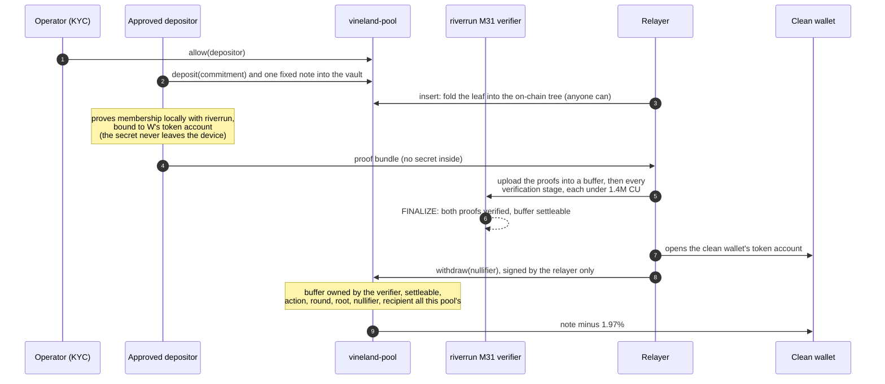

# Vineland

### The post-quantum privacy layer for stablecoin payments on Solana, for businesses and AI agents.

**The payment is public. The payer isn't.**

`IslandHack V5` · `Solana devnet: live` · `post-quantum` · `no committee` · `for businesses and AI agents` · `MIT`

---

Stablecoins made dollars programmable. They also made every payment public. On a public ledger, a company that pays its suppliers in USDC publishes its supplier list, its volumes, its payroll and its treasury moves to anyone with an explorer. For a business, that is not transparency. It is operational data, and it is the reason serious money stays off public rails.

Vineland is a privacy layer a business, or an AI agent's operator, puts in front of its payouts. It removes exactly one thing from the public record: **the link between who paid and who got paid.** Everything an auditor needs stays on chain: who was allowed in, how much moved, and when.

- **Approved at the door.** An operator allowlists wallets after KYC. Nobody else can enter.
- **Private on the way out.** A note leaves the vault to a brand-new wallet, submitted by a relayer. The depositor never signs the payout, and nothing on chain says which approved depositor it came from.
- **Post-quantum, because a ledger is forever.** Everything that authorizes a payout and links it to a deposit is a hash: the commitment, the nullifier, the on-chain tree, and a riverrun Circle-STARK. No elliptic curves, no trusted setup. Payments recorded today stay private even against a future quantum computer.
- **Verified by the chain, not by a committee.** The proofs are **verified on Solana itself**, staged across transactions, and the membership root is computed on chain from the deposits. No signer can approve a payout.
- **For businesses and AI agents.** Any approved wallet, a company's or an agent's, pays through the same relayer HTTP API and CLI. An agent's payments stop revealing who it works for and which services it buys.
- **A public way out.** A depositor can reclaim their full note publicly, with no fee, by revealing the note's secret. Nobody's signature is needed and the refund can only go to the depositor. A note leaves exactly once, privately or publicly, never both.

---

## Evaluate it in 60 seconds

| what to check | where |
|---|---|
| The program: allowlist, vault, on-chain tree, verified withdrawal, exit, fee | [`programs/vineland-pool/src/lib.rs`](programs/vineland-pool/src/lib.rs) |
| 9 program tests, each refusal asserting its exact error code | [`programs/vineland-pool/tests/pool.rs`](programs/vineland-pool/tests/pool.rs) |
| End to end, nothing mocked: real notes, on-chain tree, real proofs verified by the verifier program, payout | [`client/tests/committee_free.rs`](client/tests/committee_free.rs) |
| The whole flow **on Solana devnet**, 239 transactions, every refusal named, each signature linked | [`docs/DEVNET_RUN_COMMITTEE_FREE.md`](docs/DEVNET_RUN_COMMITTEE_FREE.md) |
| The private payout itself: one signer (the relayer), one program, clean wallet `0 -> 980,300` | [explorer (devnet)](https://explorer.solana.com/tx/Sg7NfZ2zgYiApPmxko1HRnRQmv6CmWGG6RACVjQPcg8yZ9wYRzeeDgmDqLEmqHrKq2uwQ14L3YhHawryJ59t9Cw?cluster=devnet) |
| The on-chain verification finishing: both proofs verified, buffer marked settleable | [FINALIZE (devnet)](https://explorer.solana.com/tx/2h6eEf5sEfkqXvdgVmG9m87o7uoRYmT77qmt76kyZeTun7BH2RvAdYSLevKHk1q9jRrXRyn4stCMgSR79yEHdzhp?cluster=devnet) |
| The dashboard a company signs into (Privy email login, embedded Solana wallet) and the same JSON API for AI agents | [`dashboard/`](dashboard), [`client/src/bin/vineland-node.rs`](client/src/bin/vineland-node.rs) |
| A relayer service and a user CLI, run together on a local validator | [`client/src/bin/relayer.rs`](client/src/bin/relayer.rs), [`client/src/bin/vineland.rs`](client/src/bin/vineland.rs), [`client/scripts/local_e2e.sh`](client/scripts/local_e2e.sh) |
| The pitch deck, 10 slides | [`docs/vineland-deck.pdf`](docs/vineland-deck.pdf) |

---

## What you see on the explorer

```
 ENTRY: public, attributable                        EXIT: public, unlinked

 approved wallet --deposit 1 note--> [ vault ] --payout--> brand-new wallet
                                         |       signed by a relayer only,
                                         |       authorized by a STARK the chain verified
                                         +-----> treasury (1.97%)
```

| anyone can see | nobody can see |
|---|---|
| which approved wallets deposited, and when | which deposit a payout came from |
| every amount (every note is the same size) | the depositor's secret |
| every payout, its recipient and its time | whether two payouts trace to the same depositor |
| the membership root and every spent nullifier | the link between a deposit and its nullifier |

### Where it sits

| approach | who can use it | amounts | who paid whom | trusted setup |
|---|---|---|---|---|
| plain SPL transfer | anyone | public | public | none |
| confidential balances | anyone | hidden | public | none (classical ElGamal) |
| open privacy pools | anyone | hidden or fixed | hidden | often a ceremony |
| **Vineland** | **approved wallets only** | **public, fixed note** | **hidden among approved depositors** | **none (hash-only STARKs)** |

Compliance happens at the entry, not by surveilling the exit. That is the design choice that makes private payments usable by businesses that answer to regulators.

---

## Use it: the dashboard

`vineland-node` runs on the payer's own machine and serves the dashboard at `http://localhost:8790`. It keeps the notes (each secret is the money) in files only that user can read, proves on that machine, and sends the relayer nothing but a recipient-bound proof.

- **A company** signs in with email through Privy and gets an embedded Solana wallet. The operator approves that wallet (KYC at the door), the wallet signs its deposits in the browser, and paying a supplier is a form: recipient, reference, Pay privately. The dashboard shows the proof being made locally, then Solana verifying it, then the payout with its explorer link. Every payout leaves a receipt only the company holds, exportable as CSV for its auditor.
- **An AI agent** runs the same node with its own approved wallet (`VINELAND_KEYPAIR`) and calls the same API with the bearer token the node prints: `POST /api/pay {"to": ..., "notes": 1, "reference": ...}`, then polls `GET /api/jobs/<id>`.
- **Local only by construction:** the node binds 127.0.0.1, every API call needs the token, the Host header must be the node (no DNS rebinding) and a POST must come from its own origin (no cross-site requests). It refuses mainnet.

```bash
cd client && cargo build --release --bins
target/release/vineland-node setup            # a demo pool on devnet: operator, test dollar, two seed notes
RELAYER_KEYPAIR=~/.vineland/devnet/relayer.json target/release/relayer &
cd ../dashboard && bun install && VITE_PRIVY_APP_ID=<your Privy app id> bunx vite build
cd ../client && target/release/vineland-node  # http://localhost:8790
```

On devnet a private payment takes about ten minutes today (about 213 transactions to verify the proof on chain); the dashboard and the relayer report each step.

---

## Demo: committee-free, on Solana devnet

`client/src/bin/devnet_committee_free.rs` runs the whole lifecycle against the two deployed programs, with distinct keys for every role: an operator, three approved members, a relayer, and a clean wallet that nobody ever funds. There is no committee key anywhere in the run. Recorded in [`docs/DEVNET_RUN_COMMITTEE_FREE.md`](docs/DEVNET_RUN_COMMITTEE_FREE.md):

| step | result |
|---|---|
| a key that was never approved tries to deposit | **refused** `0xbc4` (no allowlist entry) |
| three approved members each deposit one 1,000,000-unit note | settled |
| leaf 1 folded into the tree before leaf 0 | **refused** `0x1774` (`OutOfOrder`) |
| each deposit folded into the on-chain Poseidon2-M31 tree (3 transactions per leaf) | settled; the program's root equals the client's |
| member 0 proves membership **on their own machine**, bound to the clean wallet's token account | 4,986 ms; binding 109,377 B + membership 84,257 B |
| the verifier program checks both proofs on chain | 213 transactions in 618 s |
| a withdrawal one step before the verifier finished | **refused** `0x1771` (`ProofNotVerified`) |
| the relayer names its own account as recipient | **refused** `0x1772` (`ProofMismatch`: the proofs are bound to the clean wallet) |
| the relayer pays the never-funded clean wallet | **980,300 received** (1,000,000 note, 1.97% fee) ([explorer](https://explorer.solana.com/tx/Sg7NfZ2zgYiApPmxko1HRnRQmv6CmWGG6RACVjQPcg8yZ9wYRzeeDgmDqLEmqHrKq2uwQ14L3YhHawryJ59t9Cw?cluster=devnet)) |
| the same withdrawal replayed | **refused** `0x0` (nullifier already spent) |
| the withdrawn note also tries to exit | **refused** `0x0` (same nullifier) |
| member 2's note exited with member 1's secret | **refused** `0x1778` (`SecretMismatch`) |
| member 2 exits publicly by revealing its secret | full note refunded, no fee ([explorer](https://explorer.solana.com/tx/3QYDhzkquiENDEWeN47YfLdx7CWfjuLuj8RHsmb6LBsbQoeok8sSwpSfm2WhNrgAkuCgCfjvgJGxEHZ4gEojb74B?cluster=devnet)) |
| the relayer closes the verifier buffer | its rent comes back |

Read back from the devnet RPC, the payout transaction has one signer, the relayer, invokes one program, the pool (no signature precompile, no committee), uses 25,836 CU, and moves exactly: vault `3,000,000 -> 2,000,000`, clean wallet `0 -> 980,300`, treasury `0 -> 19,700`.

The committee version this replaces is still deployed at `AsQwEN7XiUPW2MGHEbEkh8UCKixwpSBfE1KKt5QVgYgx`, with its own devnet run in [`docs/DEVNET_RUN.md`](docs/DEVNET_RUN.md).

---

## How it works



**A note** is one secret. Its commitment is `Poseidon2(secret ‖ action)` and its nullifier `Poseidon2(secret ‖ round)`, over the Mersenne-31 field. `action` and `round` are derived on chain from the pool's address, so nobody chooses them. One note, one nullifier, forever.

**The deposit tree** is riverrun's depth-127 sparse Merkle tree over the commitments, **folded on chain**: one level is one Poseidon2-M31 compression (about 21k CU), so a leaf takes three `insert` transactions. The program keeps the last 16 roots; a withdrawal must name one of them. Nobody publishes a root.

**A withdrawal** is a pair of riverrun crowd proofs (binding and membership) composed on a blinded commitment, so the leaf appears in no public input, and **bound to the recipient**: under any other recipient the verifier refuses them, so the uploaded bytes are useless to a watcher.

**The verifier** is riverrun's staged M31 Circle-STARK verifier, split at its Fiat-Shamir seams into stages that each fit one transaction. Every challenge is derived on chain from the sealed bytes; no stage takes client input it could be lied to with.

### Instructions

| instruction | who | what it enforces |
|---|---|---|
| `initialize` | operator | one mint, one note size, fee (capped at 10%), floor `k_min`; contexts derived from the pool address |
| `allow` / `revoke` | operator | who may deposit; revoking never traps a note already inside |
| `deposit` | approved wallet | one note into the vault, one record per commitment |
| `insert` | anyone | folds the next deposit into the tree, strictly in deposit order |
| `withdraw` | any relayer | a buffer owned by the verifier program (fixed in code), finalized as settleable, kind crowd and bound; action, round, nullifier and recipient equal to this pool's; a root this program computed covering `>= k_min` live notes; an unspent nullifier |
| `exit` | anyone, refund to the depositor only | the revealed secret recomputes this deposit's commitment and the named nullifier; full refund, same nullifier as a withdrawal |

Every digest the program accepts is 8 canonical Mersenne-31 limbs. Anything else is refused (`NonCanonical`), so one field element has exactly one encoding and one nullifier account.

---

## Trust model

| | trusted? | why |
|---|---|---|
| **Soundness** | no signer | the proofs are verified on chain; the root is computed on chain |
| **Privacy** | no | the proof hides which deposit it is; the relayer and the chain see the nullifier and the recipient only |
| **Custody** | no | the vault belongs to the pool's program address; no key can move a note directly |
| **The relayer** | no | the recipient is bound into the proofs; a relayer can only deliver to it or not at all |
| **The operator** | for the allowlist | it decides who may deposit; it cannot publish a root, approve a payout, or block an exit |
| **The two programs** | yes | their code and their upgrade authorities (devnet: the author's key) |

**Post-quantum, precisely.** Everything that authorizes a payout is a hash: the commitment, the nullifier, the on-chain tree, and the STARK the chain verifies. Spending a note needs no elliptic-curve signature from its owner. What remains classical is Solana's own transaction signatures (the relayer's fee payment, a depositor's deposit, the operator's allowlist), which can neither redirect a payout nor forge one.

**What the anonymity set is.** The deposits under the root a withdrawal names, minus public exits. It counts deposits, not people: the operator, who controls the allowlist, could fill it with its own notes. riverrun's ruler measures effective anonymity instead of advertising it: on a live Solana mainnet pool, an advertised `k = 30` was worth an effective 6.5, and a lone depositor exactly 1.

**Known limits.** An exit reveals the note's secret in its transaction; if that transaction does not land, resend it at once (a copied secret would need a full ~200-transaction verification to be used). Only the last 16 roots are accepted, so a proof older than 16 deposits must be remade. Verification costs about 213 transactions and ~1.37 SOL of buffer rent up front (returned on close); Solana's 4 KB transactions, live since September 2026, would cut the upload part about fourfold.

**Not audited.** Devnet only. An external audit and production review come before mainnet.

---

## Measured results

| | |
|---|---|
| program tests (LiteSVM) | **9 passing**, each refusal asserting its error code |
| end to end, nothing mocked (LiteSVM, three runs) | 213 verification transactions, heaviest **1,208,835 to 1,209,378 CU** (86.4% of the 1.4M cap) |
| `insert`, per leaf | 3 transactions, at most 950,226 CU each |
| `withdraw` / `exit` | 35,134 to 41,134 / 65,490 to 68,470 CU (LiteSVM, three runs); 25,836 CU for the devnet withdrawal |
| proofs | binding 109,377 B + membership 84,257 B, proved in 4,986 ms on a laptop (devnet run) |
| on Solana devnet | 239 transactions in 703 s, 213 of them on-chain verification |
| relayer + CLI on a local validator | withdrawal through the relayer in 216 transactions, clean wallet `0 -> 980,300` holding no SOL |
| riverrun on Stellar mainnet, prior work | [post-quantum membership proof verified on chain, 11 Aug 2026](https://stellar.expert/explorer/public/tx/9f776be5c0f96cd847c923a286bd7b06b4fbf48c395e85497ac4befebcf35084) |

---

## Built during IslandHack V5

| before the hackathon | during the hackathon (19 Oct to 11 Nov 2026) |
|---|---|
| riverrun: Poseidon2-M31 Circle-STARK relations, hiding crowd proofs, the anonymity ruler | `vineland-pool`: the Solana program, first with a committee, then committee-free with the on-chain tree |
| riverrun rounds on Solana devnet | riverrun's staged on-chain verifier and its recipient binding, deployed to devnet |
| Vineland on Stellar: membership verifier on mainnet | `vineland-client`: notes, proving, staged verification, the relayer service, the CLI, the devnet runs |

---

## Business model

A one-time **1.97% protocol fee** on each private payout, enforced by the program and paid to the pool's treasury. Reclaiming your own note is free. One fee, on the value that actually moves privately, with no subscription to start.

Who pays it: businesses paying suppliers, payroll and partners in stablecoins, treasuries moving between venues, and platforms that settle on behalf of their users. All of them need payments that are verifiable without publishing their counterparties.

---

## Roadmap

1. **4 KB transactions** for the proof upload, and a hosted relayer with its fee.
2. **KYC credentials** through the Solana Attestation Service instead of an operator-held allowlist.
3. **Proving in the browser**: the riverrun prover already compiles to WebAssembly.
4. **Real devnet USDC**, then production review, external audit, mainnet.

---

## Run it

Prerequisites: the Solana toolchain with `cargo-build-sbf`. riverrun is a git dependency pinned to `ce5e8c7` of [`feat/staged-onchain-verifier`](https://github.com/Galmanus/mirror-pool/tree/feat/staged-onchain-verifier); Cargo fetches it.

```bash
# the program and its tests
cd programs/vineland-pool && cargo-build-sbf && cargo test --release

# the verifier exactly as deployed on devnet
solana program dump -u devnet 8vPHUTH27WXYNvNoaBTJGWWceNSVrNXHZSTYkaywkcYo /tmp/riverrun_m31_verifier.so

# client tests, then the committee-free end to end with real proofs (needs --release)
cd ../../client && cargo test --release --lib
RIVERRUN_VERIFIER_SO=/tmp/riverrun_m31_verifier.so cargo test --release --test committee_free -- --ignored --nocapture

# the whole system on a local validator: CLI + relayer + both programs
RIVERRUN_VERIFIER_SO=/tmp/riverrun_m31_verifier.so scripts/local_e2e.sh

# the committee-free flow on devnet (funds every role from the default CLI wallet; needs ~2 SOL there)
cargo run --release --bin devnet_committee_free
```

---

## Links

- Vineland: https://vineland.app
- riverrun, the proof engine: https://github.com/Galmanus/mirror-pool
- Pool program (devnet): `3W1FD5Q1ELFzVAoJUasSj3aZGmgs4zrRdgfZZV1K5VXi`
- Verifier program (devnet): `8vPHUTH27WXYNvNoaBTJGWWceNSVrNXHZSTYkaywkcYo`

Built by Manuel Guilherme, Brazil. MIT licensed.
