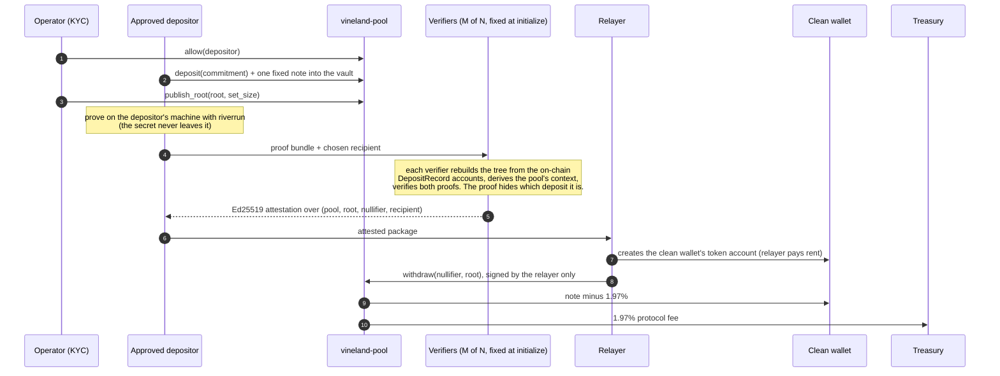

# Vineland on Solana

**Private authorization for public money.** The payment is public. The payer isn't.

`local validator: full flow green` · `devnet: deploy pending` · `committee-gated membership` · `IslandHack V5`

Vineland is an allowlisted payment pool on Solana. An operator approves wallets at the door (KYC happens before a key can enter). An approved wallet deposits one fixed-size note of a USDC-style token into the pool's vault. Later that note is paid out to a brand-new wallet, in a transaction a relayer submits, so the depositor's key never signs the payout. Anyone can see that a note entered, that a note left, how much, and when. Nobody can see which approved depositor the payout came from.

The membership check underneath is riverrun: post-quantum, hash-based Circle-STARK proofs with no trusted setup. Every value Vineland writes on chain that relates a payout to a deposit is a hash.

---

## Why it matters

Stablecoins made dollars programmable, and they made payments public. On a public ledger a company's transfers reveal its suppliers, its buyers, its payroll and its treasury moves. For a business that is not transparency. It is operational data.

The usual fixes hide the wrong thing:

| approach | who may use it | amounts | who paid |
|---|---|---|---|
| plain SPL transfer | anyone | public | public |
| confidential balances | anyone | hidden | public |
| open privacy pools | anyone | hidden or fixed | hidden |
| **Vineland** | **approved wallets only** | **public, fixed note** | **hidden among approved depositors** |

Vineland keeps what an auditor needs (who was allowed in, how much moved, when) and removes the one thing a business cannot publish: the link between payer and payee.

---

## How it works



What the explorer shows:

```
 ENTRY (public, attributable)                  EXIT (public, unlinked)

 approved wallet --deposit 1 note--> [ pool vault ] --withdraw--> clean wallet
                                           |        signed by the relayer
                                           +------> treasury (1.97%)
```

| public | private |
|---|---|
| which approved wallets deposited, and when | which deposit a payout came from |
| every amount (all notes are the same size) | the depositor's secret |
| every payout, its recipient and its time | whether two payouts trace to the same depositor |
| the membership root and the spent nullifiers | the link between a commitment and its nullifier |

### The program (`programs/vineland-pool`)

- `initialize`: one SPL mint, one note size, a fee in basis points (capped at 1,000), a floor `k_min`, and a verifier committee of up to 8 keys with threshold `M`. **The committee is fixed here.** There is no instruction to replace it; rotation means opening a new pool.
- `allow` / `revoke`: the operator approves or withdraws a key. Revoking gates future deposits only; a note already in the pool stays withdrawable and exitable.
- `deposit(commitment)`: only an approved key. Moves one note into the vault and writes a `DepositRecord` (pool, depositor, commitment, index), 110 bytes, `pool` at offset 8.
- `publish_root(root, set_size)`: the operator publishes the membership root and how many deposits it covers (never more than exist).
- `withdraw(nullifier, root)`: any relayer. Requires `M` distinct committee attestations over exactly `(pool, root, nullifier, recipient)`, the current root, and `set_size - exits >= k_min` (exits are public, so they do not count). Creates the nullifier account, so a second spend fails. Pays `note - fee` to the recipient and `fee` to the treasury.
- `ragequit(commitment, nullifier)`: the original depositor reclaims the full note to their own token account, with a committee attestation that the nullifier belongs to that commitment. It burns the same nullifier account a withdrawal would, so a note leaves once.
- Every digest the program accepts (commitment, root, nullifier) must be **8 canonical Mersenne-31 limbs, u32 little-endian, 32 bytes**: each limb below `2^31 - 1`. Anything else is refused with `NonCanonical` (6013), so one field element has exactly one encoding and one nullifier account.

### The verifier check (`client/src/lib.rs`)

Before signing a withdrawal, each verifier, independently:

1. fetches the pool's `DepositRecord` accounts (one `getProgramAccounts` with a memcmp on the pool at offset 8 and data size 110) and rebuilds the depth-127 tree from them;
2. refuses with `RootNotTheDeposits` if the root the operator published is not that tree's root, and with `RootNotCurrent` if the bundle was proven against another root;
3. derives the pool's `action` and `round` itself, from the pool address (SHA-256 of `vineland/note/v1` or `vineland/spend/v1` plus the pool, masked to M31), never from the bundle. One note has one nullifier, per pool;
4. verifies the binding and membership proofs, composed on a blinded commitment, so the leaf is in no public input.

For an exit, the depositor reveals the blinder; the verifier recomputes `C = compress(commitment, blinder)` and checks the binding proof, so the exit's nullifier provably belongs to that commitment.

---

## Built and measured

Measured on a laptop, not on a validator, unless it says local validator.

| item | result |
|---|---|
| program tests (LiteSVM, `programs/vineland-pool/tests/pool.rs`) | 18 passing. Every rejection asserts its error code; three checks (in two tests) accept either of two codes where the framework refuses before the program does |
| client end-to-end tests with real proofs (`client/tests/e2e.rs`) | 2 passing |
| binding proof | 113,335 to 113,397 B across three runs (proofs are randomized, so sizes vary) |
| membership proof | 82,723 to 82,793 B across the same runs |
| proving both proofs | 2,899 to 2,954 ms |
| one verifier's full check (both proofs plus the tree rebuild) | 8 to 11 ms |
| withdraw transaction, committee of 2 | 1,091 B of Solana's 1,232 B limit |
| exit transaction | 1,027 B |
| deposit transaction | 474 B |
| full demo on a local validator (`solana-test-validator`, agave 4.3.0) | the clean wallet, never funded, received 980,300 of a 1,000,000 note (197 bps fee) |

Refused on the local validator, with the program's own codes (`docs/LOCAL_RUN.md`):

| attempt | result |
|---|---|
| deposit before approval | `0xbc4` (3012, `AccountNotInitialized`: no allowlist entry) |
| replay the same withdrawal | `0x0` (`AccountAlreadyInUse`: nullifier already spent) |
| the withdrawn note also tries to exit | `0x0` (`AccountAlreadyInUse`) |
| withdraw below the floor after an exit | `0x1776` (6006, `AnonymitySetTooSmall`) |

Committee size and transaction size: with `M = 2` the withdraw transaction is 1,091 B (measured). Each extra attestation adds about 256 B of instruction data (computed from the layout, not measured), so `M = 2` is what fits with margin.

---

## What is live on devnet

Nothing yet. The program ID is `AsQwEN7XiUPW2MGHEbEkh8UCKixwpSBfE1KKt5QVgYgx`, and the program is **not yet deployed to devnet**. The devnet run writes `docs/DEVNET_RUN.md` with the same shape as `docs/LOCAL_RUN.md` (every signature, the pool, the mint, the clean wallet, and the refusals); this section links it once it exists. The demo's constants: a 1,000,000 base-unit note of a 6-decimal test dollar, 197 bps, `k_min` 3, a 2-of-2 committee.

---

## Reproduce

Prerequisites: the Solana toolchain with `cargo-build-sbf`; riverrun checked out **next to this repo** (the client depends on it by path); for the local run, `solana-test-validator` and a funded default CLI wallet (`~/.config/solana/id.json`), which the demo uses only to fund fresh roles.

```bash
# riverrun, next to this repo
git clone https://github.com/Galmanus/mirror-pool ../mirror-pool
(cd ../mirror-pool && git checkout feat/behavioral-pool-provenance-tracer)

# the program: build, then 18 LiteSVM tests
cd programs/vineland-pool && cargo-build-sbf && cargo test

# the client: 2 end-to-end tests with real proofs (proving needs --release)
cd ../../client && cargo test --release

# the full flow against a local validator (starts one with the program loaded,
# runs the demo, then stops it and deletes its ledger)
cd .. && scripts/local_validator.sh

# the same flow on devnet, once the program is deployed
cd client && cargo run --release --bin devnet_demo
```

The client's `Cargo.lock` was seeded from riverrun-m31's lock to pin Plonky3 0.6.2. The demo writes `docs/LOCAL_RUN.md` (with `VINELAND_RPC` set) or `docs/DEVNET_RUN.md`.

---

## Honest scope

**Committee-gated today.** A riverrun proof pair is about 196 KB and one on-chain verification costs more than a Solana transaction's compute cap, so the program does not verify it. `N` verifier keys check the proofs off chain and `M` of them sign Ed25519 attestations that the program checks through the native precompile.

What that trusts:

- **Soundness.** `M` colluding verifiers can approve a payout that no proof backs. Nothing on chain stops that today.
- **The operator, for liveness and the allowlist.** It decides who may deposit and when a root is published. It is not trusted for custody: it cannot replace the committee, and a root over leaves nobody deposited gets no signature from an honest verifier.

What it does not trust:

- **Privacy.** A verifier learns the nullifier and the recipient, never which deposit it was.
- **Custody.** The vault's authority is the pool's program address. No instruction lets the operator or a verifier move a note directly.

**Recipient binding.** The recipient is inside the signed message, so a relayer handed an attested package cannot redirect it (`the_relayer_cannot_redirect_the_payout`). The residual risk: a member who lets the relayer request the attestation lets the relayer choose the recipient. The real fix is binding the recipient inside the proof; that is on the roadmap.

**No root history.** Only the current root is accepted. A new root invalidates attestations in flight, and the member proves again.

**Post-quantum, precisely.** The privacy record is post-quantum: what relates a payout to a deposit on chain is hashes, so harvesting the ledger today and running Shor later recovers nothing. Settlement authorization is not post-quantum yet: Ed25519 attestations and Solana's own signatures fall to Shor. On-chain STARK verification is what moves soundness onto hashes too.

**Security level.** The proof parameters (12 FRI queries, blowup 2^7, the point riverrun's crowd tests use) are demonstration grade, not production grade. riverrun's own soundness accounting (`crates/riverrun-m31/examples/soundness_budget.rs` and the whitepaper) is the place to read the bit counts; production parameters come before mainnet.

**What the anonymity set is.** At most the deposits under the current root minus the public exits. One approved wallet that deposits many notes shrinks everyone else's set (the self-fill floor); there is no per-depositor cap yet. Funding-graph analysis can shrink it further, and riverrun's ruler measures that instead of assuming it: on a live Solana mainnet pool, an advertised `k = 30` was worth an effective 6.5, and a lone depositor exactly 1 (riverrun's README).

**Verifier and relayer are roles, not services.** In this build they run inside the demo binary; there is no hosted relayer or verifier network yet.

**Not audited.** Devnet only. An external audit comes before any mainnet deployment.

---

## Built before vs during IslandHack V5

| before the window (riverrun and Vineland on Stellar, Jul to Oct 2026) | during the window (19 Oct to 5 Nov 2026) |
|---|---|
| riverrun engine: Poseidon2-M31 Circle-STARK relations, hiding crowd proofs, the funding-graph ruler | `vineland-pool`: allowlist, fixed-note SPL vault, committee-gated withdrawal to a clean wallet, ragequit on the same nullifier, fixed committee, on-chain canonicity, floor net of exits, 1.97% fee; 18 tests |
| riverrun rounds on Solana devnet (18 actions in one transaction) | `vineland-client`: notes, the deposit tree rebuilt from chain, proving, the verifier checks, transaction builders; 2 end-to-end tests with real proofs |
| riverrun's verifier executed in a Solana VM (LiteSVM, 2,384,277 CU for a 4-query proof of the earlier binding relation, `programs/riverrun-m31-verifier`) | the full demo on a local validator; devnet run pending |
| Vineland on Stellar: membership verifier on mainnet | staged on-chain STARK verification: in progress |

---

## Roadmap

1. **Staged on-chain verification.** Split one STARK verification across transactions to fit the 1.4M CU cap. Starting point: 2,384,277 CU for a 4-query proof of an earlier binding relation in LiteSVM, about 348k CU per FRI query (`programs/riverrun-m31-verifier` in riverrun). In progress. This removes the committee from soundness.
2. **Recipient inside the proof**, so no party but the prover can choose it.
3. **On-chain root**, computed from deposits instead of published by the operator.
4. **Prover in the browser.** The riverrun prover already compiles to WebAssembly; wire it into the wallet flow.
5. **Hosted relayer and an independent verifier set.**
6. **Production parameters and an external audit**, then mainnet.

---

## Links

- Repo: https://github.com/Galmanus/vineland-sol
- Demo video: coming with the devnet run
- riverrun engine: https://github.com/Galmanus/mirror-pool (branch `feat/behavioral-pool-provenance-tracer`)
- 18 riverrun actions in one devnet transaction: https://explorer.solana.com/tx/3SageKBifChN4t1iBnUX13riYDF1zN9UmGqp8cnfi4Pf3tzJJEnsWpiHVG9BJhdVRS4f9QvYTh5s6QAkTgSKQfCQ?cluster=devnet
- Vineland: https://vineland.app
- Post-quantum membership proof verified on Stellar mainnet (11 Aug 2026): https://stellar.expert/explorer/public/tx/9f776be5c0f96cd847c923a286bd7b06b4fbf48c395e85497ac4befebcf35084

MIT. Built by Manuel Guilherme.
