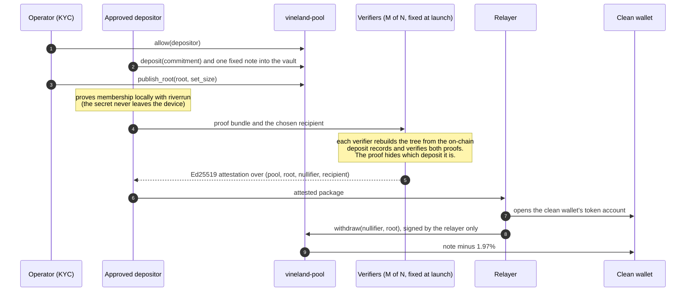

# Vineland

### Private authorization for public money, on Solana.

**The payment is public. The payer isn't.**

`IslandHack V5` · `Solana` · `local validator: full flow green` · `devnet: deploying` · `post-quantum membership proofs` · `MIT`

---

Stablecoins made dollars programmable. They also made every payment public. On a public ledger, a company that pays its suppliers in USDC publishes its supplier list, its volumes, its payroll and its treasury moves to anyone with an explorer. For a business, that is not transparency. It is operational data, and it is the reason serious money stays off public rails.

Vineland removes exactly one thing from the public record: **the link between who paid and who got paid.** Everything an auditor needs stays on chain: who was allowed in, how much moved, and when.

- **Approved at the door.** An operator allowlists wallets after KYC. Nobody else can enter.
- **Private on the way out.** A note leaves the pool to a brand-new wallet, submitted by a relayer. The depositor never signs the payout, and nothing on chain says which approved depositor it came from.
- **Proven, not trusted.** Membership is proven with riverrun Circle-STARKs: hash-only, no trusted setup, post-quantum, and the proof hides which deposit it refers to.
- **Never trapped.** A depositor can always reclaim their own note publicly. A note leaves exactly once, privately or publicly, never both.

---

## Evaluate it in 60 seconds

| what to check | where |
|---|---|
| The program: allowlist, vault, private withdrawal, exit, fee | [`programs/vineland-pool/src/lib.rs`](programs/vineland-pool/src/lib.rs) |
| 18 tests, one per invariant, each asserting the exact error code | [`programs/vineland-pool/tests/pool.rs`](programs/vineland-pool/tests/pool.rs) |
| End to end with **real STARK proofs**: prove, verify, settle, refuse | [`client/tests/e2e.rs`](client/tests/e2e.rs) |
| The full flow on a Solana validator, every step and every refusal | [`docs/LOCAL_RUN.md`](docs/LOCAL_RUN.md) |
| Run it yourself, one command | `scripts/local_validator.sh` |

---

## What you see on the explorer

```
 ENTRY: public, attributable                     EXIT: public, unlinked

 approved wallet --deposit 1 note--> [ pool vault ] --payout--> brand-new wallet
                                            |        signed by a relayer only
                                            +-----> treasury (1.97%)
```

| anyone can see | nobody can see |
|---|---|
| which approved wallets deposited, and when | which deposit a payout came from |
| every amount (every note is the same size) | the depositor's secret |
| every payout, its recipient and its time | whether two payouts trace to the same depositor |
| the membership root and every spent nullifier | the link between a deposit and its nullifier |

### Where it sits

| approach | who can use it | amounts | who paid whom |
|---|---|---|---|
| plain SPL transfer | anyone | public | public |
| confidential balances | anyone | hidden | public |
| open privacy pools | anyone | hidden or fixed | hidden |
| **Vineland** | **approved wallets only** | **public, fixed note** | **hidden among approved depositors** |

Compliance happens at the entry, not by surveilling the exit. That is the design choice that makes private payments usable by businesses that answer to regulators.

---

## Demo: the full flow, run on a Solana validator

`client/src/bin/devnet_demo.rs` runs the whole lifecycle with real proofs and distinct keys for every role: an operator, a 2-of-2 verifier committee, three approved members, a relayer, and a clean wallet that nobody ever funds. Local runs (`solana-test-validator`, agave 4.3.0); the latest is recorded in [`docs/LOCAL_RUN.md`](docs/LOCAL_RUN.md):

| step | result |
|---|---|
| a key that was never approved tries to deposit | **refused** `0xbc4` (no allowlist entry) |
| three approved members each deposit one 1,000,000-unit note | settled |
| the operator publishes the membership root | settled |
| member 0 proves membership **on their own machine** | about 2.9 s; the secret never leaves the device |
| each verifier rebuilds the tree from chain, verifies, signs | 8 to 11 ms per verifier |
| the relayer pays the never-funded clean wallet | **980,300 received** (1,000,000 note, 1.97% fee), 1,091-byte transaction |
| the same withdrawal replayed | **refused** `0x0` (nullifier already spent) |
| the withdrawn note also tries to exit | **refused** `0x0` (same nullifier) |
| member 2 exits publicly | full note refunded, no fee |
| a withdrawal after that exit, below the anonymity floor | **refused** `0x1776` (`AnonymitySetTooSmall`) |

The devnet run uses the same binary and writes `docs/DEVNET_RUN.md` with explorer links for every signature.

---

## How it works



**A note** is one secret. Its commitment is `Poseidon2(secret ‖ action)` and its nullifier `Poseidon2(secret ‖ round)`, over the Mersenne-31 field, with `action` and `round` fixed per pool. One note, one nullifier, forever.

**The deposit tree** is riverrun's depth-127 sparse Merkle tree over the commitments. Anyone rebuilds it from the pool's `DepositRecord` accounts with one `getProgramAccounts` call.

**A withdrawal** is a pair of riverrun crowd proofs (binding and membership) composed on a blinded commitment, so the leaf appears in no public input. About 113 KB and 83 KB, proven in under 3 seconds on a laptop.

**The program** checks a quorum of verifier signatures over the exact settlement, the current root, the anonymity floor, and that the nullifier was never spent (its account is created on use, so a second spend fails). It pays the note minus the fee to the clean wallet and the fee to the treasury.

### Instructions

| instruction | who | what it enforces |
|---|---|---|
| `initialize` | operator | one mint, one note size, fee (capped at 10%), floor `k_min`, a committee of up to 8 keys with threshold `M`, **fixed for the pool's life** |
| `allow` / `revoke` | operator | who may deposit; revoking never traps a note already inside |
| `deposit` | approved wallet | one note into the vault, one record per commitment |
| `publish_root` | operator | the root and how many deposits it covers, never more than exist |
| `withdraw` | any relayer | `M` distinct attestations, current root, `set_size - exits >= k_min`, unspent nullifier |
| `ragequit` | the depositor | full refund to their own account, burning the same nullifier a withdrawal would |

Every digest the program accepts is 8 canonical Mersenne-31 limbs. Anything else is refused (`NonCanonical`), so one field element has exactly one encoding and one nullifier account.

---

## Trust model

Proof verification is the expensive part. A riverrun proof pair is about 196 KB, and verifying it in one transaction exceeds Solana's 1.4M compute-unit cap. So today a **fixed committee** of verifier keys checks the proofs off chain and signs, and the program checks those signatures through Solana's native Ed25519 precompile.

| | trusted? | why |
|---|---|---|
| **Privacy** | no | a verifier sees the nullifier and the recipient, never which deposit it was |
| **Custody** | no | the vault belongs to the pool's program address; no key can move a note directly |
| **The operator** | for liveness and the allowlist only | it cannot replace the committee, and a root over notes nobody deposited gets no signature from an honest verifier |
| **Soundness** | yes, `M` of `N` verifiers | `M` colluding verifiers could approve a payout no proof backs |

The committee is the one assumption we are removing next: see **Committee-free settlement** below.

**Recipient binding.** The recipient is inside the signed message, so a relayer cannot redirect a payout. The depositor requests the attestation, not the relayer.

**Post-quantum, precisely.** Everything on chain that relates a payout to a deposit is a hash, so harvesting the ledger today and running Shor's algorithm later recovers nothing. Settlement signatures (Ed25519, and Solana's own) are classical today; on-chain STARK verification moves soundness onto hashes as well.

**What the anonymity set is.** The deposits under the current root, minus public exits. riverrun's ruler measures effective anonymity instead of advertising it: on a live Solana mainnet pool, an advertised `k = 30` was worth an effective 6.5, and a lone depositor exactly 1.

**Not audited.** Devnet only. The proof parameters are demonstration grade. An external audit and production parameters come before mainnet.

---

## Committee-free settlement: measured

The roadmap item that removes the committee already runs in a Solana VM. riverrun's verifier is split at its Fiat-Shamir seams into stages that each fit in one transaction, with the proof uploaded into a program-owned buffer and every challenge derived on chain.

Measured in LiteSVM at production proof parameters (12 FRI queries, blowup 128), for the full binding plus membership composition:

| | |
|---|---|
| verification transactions | 20 |
| most expensive stage | 1,209,296 CU, **86.4% of the 1.4M cap** |
| all transactions, including proof upload | 213 |
| settlement from the verified buffer (riverrun's pool) | 12,483 CU |
| a proof copied and re-aimed at another recipient | refused on chain |

The staged verifier is public in riverrun on [`feat/staged-onchain-verifier`](https://github.com/Galmanus/mirror-pool/tree/feat/staged-onchain-verifier): the protocol is in [`programs/riverrun-m31-verifier/src/staged.rs`](https://github.com/Galmanus/mirror-pool/blob/feat/staged-onchain-verifier/programs/riverrun-m31-verifier/src/staged.rs), and the LiteSVM tests that produce these numbers, under explicit 1.4M CU limits and the 1232-byte packet limit, are in [`tests/staged.rs`](https://github.com/Galmanus/mirror-pool/blob/feat/staged-onchain-verifier/programs/riverrun-m31-verifier/tests/staged.rs). Next step: wire `withdraw` in `vineland-pool` to the verified buffer, and the committee is gone.

---

## Measured results

Laptop measurements unless marked otherwise.

| | |
|---|---|
| program tests (LiteSVM) | **18 passing**, one per invariant, each asserting its error code |
| end-to-end tests with real proofs | **2 passing** |
| binding proof / membership proof | 113,335 to 113,397 B / 82,723 to 82,793 B (randomized, three runs) |
| proving both | 2,899 to 2,954 ms |
| one verifier's full check (both proofs and the tree rebuild) | 8 to 11 ms |
| withdraw / exit / deposit transaction | 1,091 / 1,027 / 474 bytes (of 1,232) |
| riverrun on Solana devnet, prior work | [18 actions settled in one transaction](https://explorer.solana.com/tx/3SageKBifChN4t1iBnUX13riYDF1zN9UmGqp8cnfi4Pf3tzJJEnsWpiHVG9BJhdVRS4f9QvYTh5s6QAkTgSKQfCQ?cluster=devnet) |
| riverrun on Stellar mainnet, prior work | [post-quantum membership proof verified on chain, 11 Aug 2026](https://stellar.expert/explorer/public/tx/9f776be5c0f96cd847c923a286bd7b06b4fbf48c395e85497ac4befebcf35084) |

Mutation-tested: removing the nullifier burn from exits, unbinding the recipient, dropping the canonical-encoding check, or dropping the anonymity floor each turns the matching test red.

---

## Built during IslandHack V5

| before the hackathon | during the hackathon (19 Oct to 5 Nov 2026) |
|---|---|
| riverrun: Poseidon2-M31 Circle-STARK relations, hiding crowd proofs, the anonymity ruler | `vineland-pool`: the Solana program and its 18 invariant tests |
| riverrun rounds on Solana devnet | `vineland-client`: notes, deposit tree, proving, verifier checks, transactions, end-to-end tests |
| Vineland on Stellar: membership verifier on mainnet | the full demo on a Solana validator; devnet deployment |
| | staged on-chain STARK verification, measured in LiteSVM |

---

## Business model

A one-time **1.97% protocol fee** on each private payout, enforced by the program and paid to the pool's treasury. Reclaiming your own note is free. One fee, on the value that actually moves privately, with no subscription to start.

Who pays it: businesses paying suppliers, payroll and partners in stablecoins, treasuries moving between venues, and platforms that settle on behalf of their users. All of them need payments that are verifiable without publishing their counterparties.

---

## Roadmap

1. **Devnet live**, with every signature linked here.
2. **Committee-free withdrawals**: `vineland-pool` settles from the on-chain verified buffer.
3. **On-chain root**, computed from deposits instead of published by the operator.
4. **Proving in the browser**: the riverrun prover already compiles to WebAssembly.
5. **Hosted relayer** and an independent verifier set.
6. **Production parameters, external audit, mainnet.**

---

## Run it

Prerequisites: the Solana toolchain with `cargo-build-sbf`, and riverrun checked out next to this repo (the client depends on it by path).

```bash
git clone https://github.com/Galmanus/mirror-pool ../mirror-pool
(cd ../mirror-pool && git checkout feat/behavioral-pool-provenance-tracer)

# the program and its 18 tests
cd programs/vineland-pool && cargo-build-sbf && cargo test

# end to end with real proofs (proving needs --release)
cd ../../client && cargo test --release

# the full demo on a local validator: starts one, runs, stops, cleans up
cd .. && scripts/local_validator.sh

# the same demo on devnet, once deployed
cd client && cargo run --release --bin devnet_demo
```

The client's `Cargo.lock` pins Plonky3 0.6.2, the version riverrun is tested against.

---

## Links

- Vineland: https://vineland.app
- riverrun, the proof engine: https://github.com/Galmanus/mirror-pool
- Program ID: `AsQwEN7XiUPW2MGHEbEkh8UCKixwpSBfE1KKt5QVgYgx`

Built by Manuel Guilherme, Brazil. MIT licensed.
